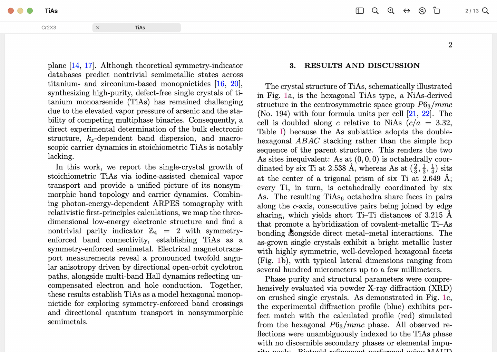
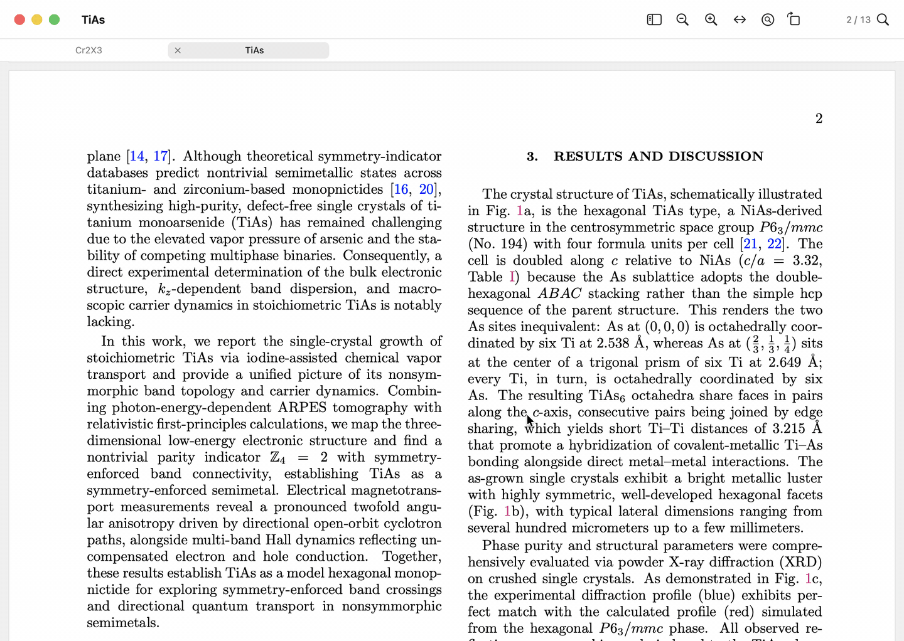
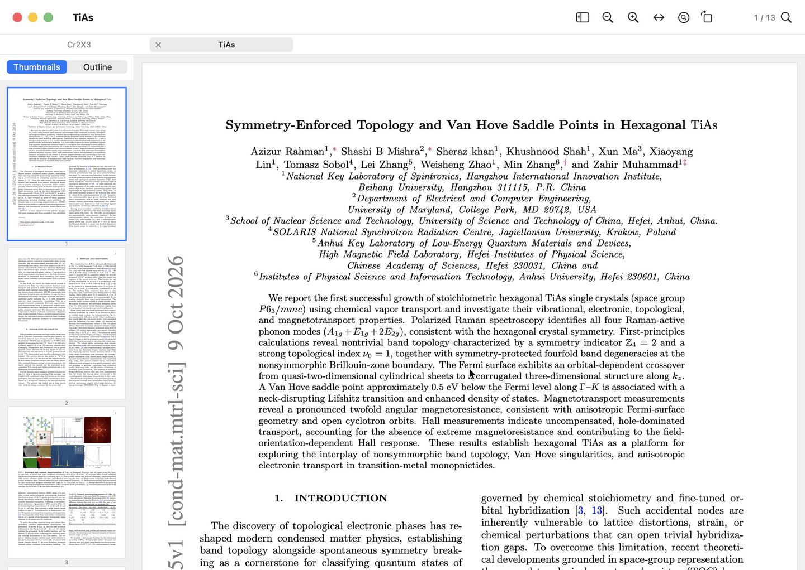
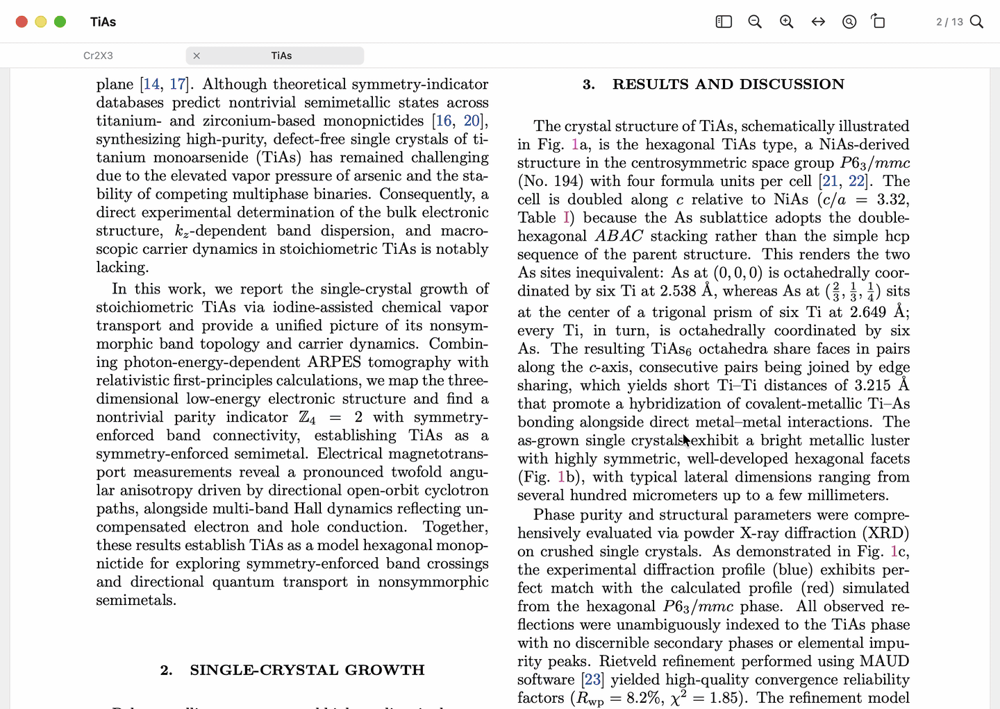

<div align="center">


# 知白 Luma

A small PDF reader for macOS, made for reading papers.

知白守墨，去繁存真

[Download](https://github.com/ma455173220/Luma-pdf-reader/releases/latest) · [中文](README.zh-Hans.md)

</div>

知白 means knowing the white: in calligraphy the empty paper matters as much as the ink. Luma keeps only what helps you read a paper and leaves the rest out. It has no library, no
account and no sync, works offline, and uses little memory: on the same paper and Mac it used about
a third less than Skim.

## Previews



Rest the pointer on a citation such as [12] and the reference appears where you are reading. Figure
and table mentions work the same way. Papers without clickable links get them too: Luma works out
the citations, figure mentions and outline from the text, and shows nothing when it is not sure.
A preview can be pinned, moved, resized and zoomed, and its text copied. A reference can be looked
up on Google Scholar.

## Annotations



Highlight, underline or strike through text in four colours and add notes. They are saved as
ordinary PDF annotations inside the file, so other readers such as Preview see them. Saving only
adds to the end of the file and never rewrites what is already there.

## Pages



Rotate, delete and reorder pages in the thumbnails, or drag in another PDF to insert or merge it.

## Magnifier



A lens that redraws the page at three times the size under the pointer, for small print in figures.

Also: tabs, thumbnails and outline, find, back and forward, and copying that joins broken lines.
The interface is in English and Simplified Chinese.

## Install

Needs an Apple silicon Mac with macOS 26 or later. Download the zip from
[Releases](https://github.com/ma455173220/Luma-pdf-reader/releases/latest), unzip it and move
知白.app to Applications. The app is not notarised, so the first time macOS blocks it: open System
Settings › Privacy & Security and click Open Anyway.

To build it yourself (Xcode 27 command-line tools):

```sh
scripts/build-app.sh    # makes build/知白.app
```

## Notes

The ideas for finding
citations, figures and outlines came from reading how [Zotero](https://www.zotero.org)'s reader does
it; the code is Luma's own. The demos use arXiv papers
[2610.12925](https://arxiv.org/abs/2610.12925), [2609.16780](https://arxiv.org/abs/2609.16780) and
[2609.24897](https://arxiv.org/abs/2609.24897), all CC BY 4.0.

MIT License.
